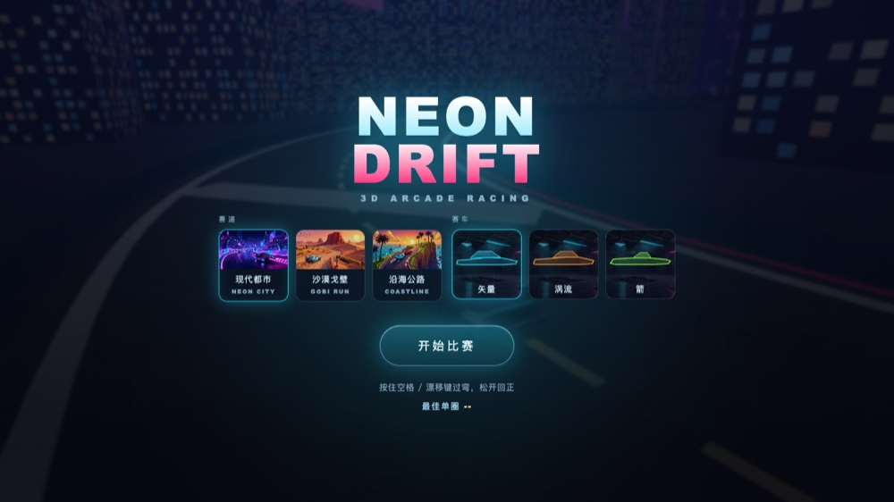
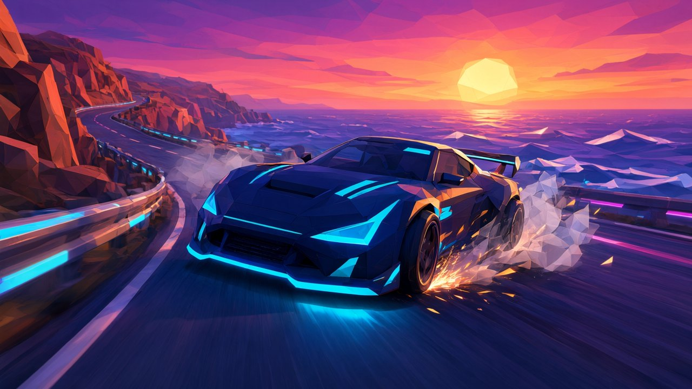
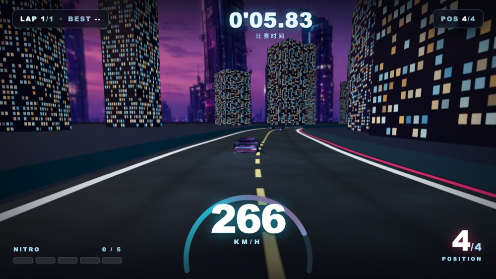
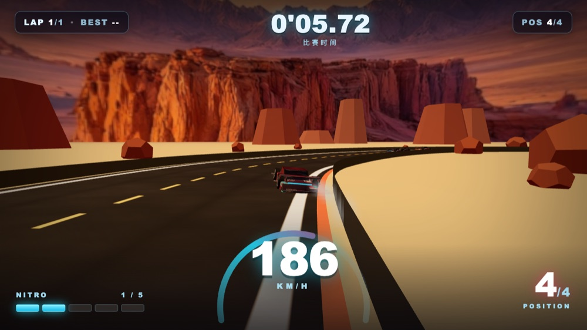
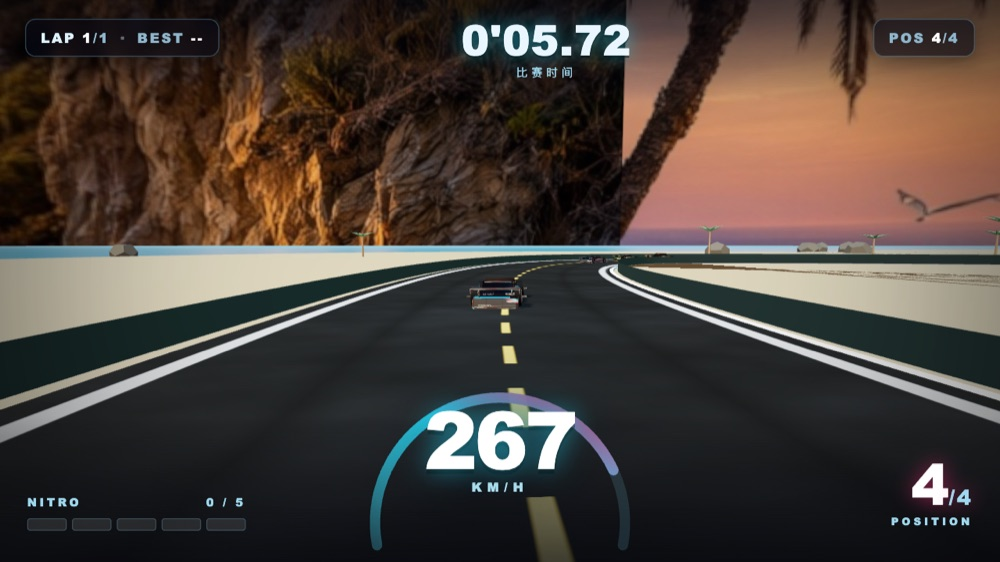
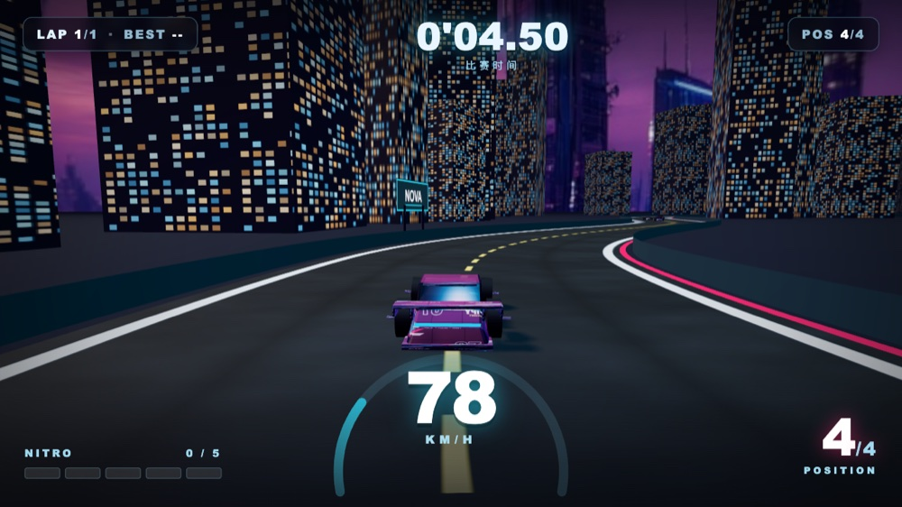
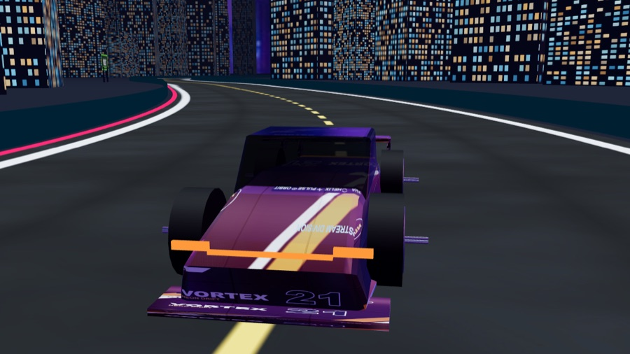
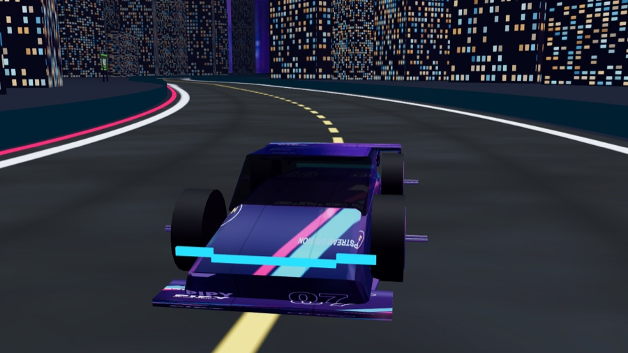
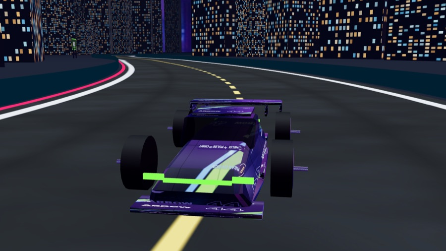

# NEON DRIFT

3D 霓虹街机竞速。**自动加速 + 一键漂移 + 漂移攒氮气**，单局约 30 秒/圈，浏览器直接跑，手机可玩。

**3 条主题赛道 × 3 款跑车**，开局可选：

| 赛道 | 风景 | 特点 |
| --- | --- | --- |
| NEON CITY 现代都市 | 霓虹夜景 + 玻璃幕墙 | 默认，视觉最"赛博" |
| GOBI RUN 沙漠戈壁 | 台地、孤峰、沙丘 | 暖色调，路面更宽 |
| COASTLINE 沿海公路 | 悬崖、沙滩、棕榈、海面 | 白天，反光最强 |

| 赛车 | 定位 | 差异 |
| --- | --- | --- |
| VECTOR 矢量 | 超级跑车 | 低趴、宽体、大尾翼（青） |
| VORTEX 涡流 | GT 跑车 | 车身高、轴距长、小尾翼（橙） |
| ARROW 箭 | 赛道特化 | 短轴距、外露车轮、大尾翼（绿） |





| 现代都市 | 沙漠戈壁 | 沿海公路 |
| --- | --- | --- |
|  |  |  |

| 路边广告牌 | 车身赞助商贴花 |
| --- | --- |
|  |  |

| VECTOR | VORTEX | ARROW |
| --- | --- | --- |
|  |  |  |

> 讲解视频（51s，含旁白字幕）：`playtest/neon-drift/neon-drift.mp4`（视频不入库，本地保留）

## 玩法

| 操作 | 键盘 | 触屏 |
| --- | --- | --- |
| 转向 | ← → / A D | 按住屏幕左 / 右半区 |
| 漂移 | 空格（按住） | 右下角「漂移」 |
| 氮气 | Shift | 左下角「氮气」 |
| 重开 | R（结算页） | 「再来一局」 |

- 油门自动，只有漂移会减速，所以决策点全在「什么时候漂」。
- 漂移时车尾外甩、抓地力下降，**同时按角度和速度攒氮气**；攒满可释放 2.3 秒加速。
- 出界只是擦墙减速，不会停死或判定失败。
- 单圈成绩存本地，第二局会和自己的**幽灵车**同场。

## 运行

必须用 HTTP 服务（ES Module + 纹理加载，`file://` 会被 CORS 拦）：

```bash
cd games/neon-drift
python3 -m http.server 8124
# http://127.0.0.1:8124/
```

演示/调试参数：`?laps=1`（单圈）、`?track=1`（换赛道，0–2）。选择会存 `localStorage`。

## 结构

```
neon-drift/
├─ index.html          入口（importmap 指向本地 three r160）
├─ styles.css          矢量 HUD 与面板（无位图）
├─ lib/three.module.js 本地内置，离线可用
├─ assets/             2048² PBR 贴图（车漆 底色/法线/ORM + 路面）
└─ src/
   ├─ config.js        手感 / 3 条赛道主题 / 文案，所有数值集中在这里
   ├─ track.js         Catmull-Rom 样条 → 等弧长采样 → 路面/护栏/霓虹边条
   ├─ env.js           主题装饰：都市亮窗楼群 / 戈壁台地碎石 / 海岸沙滩棕榈
   ├─ car.js           车辆物理（s,t 空间）+ 3 款车的参数化车模
   ├─ rivals.js        AI 对手（橡皮筋）+ 幽灵车（录制/回放）
   ├─ audio.js         WebAudio 合成音效，零音频文件
   └─ main.js          渲染、相机、粒子、状态机、HUD 更新
```

## 素材

- 天空与环境反射：AI 生成（2048×1024 equirect 全景）→ `assets/sky-*.jpg`，同时用作背景与 PMREM 环境反射。
- 赛道卡主视觉：AI 生成的游戏 key art → `assets/card-*.jpg`（480×270）。
- 海报 / OG 图：AI 生成的 key art → `poster.jpg`；赛车卡背景 → `assets/garage.jpg`。
- 车漆：`tools/gen_liveries.py` 参数化生成 3 套（07 / 21 / 44），共用一套法线与 ORM。
- 赛道卡片缩略图：`assets/thumb-*.jpg`，从天空图裁切。
- 音效：WebAudio 实时合成，无音频文件。
- **赞助商全部是虚构品牌**（NOVA / HELIX / PULSE / ORBIT / VOLT / KERNEL），车身贴花与路边广告牌共用同一套设定。**不使用任何真实公司 logo**——真实商标出现在商业游戏里会有侵权风险，也会影响分发渠道审核。

## 三个技术选择

1. **用 (s, t) 赛道空间代替物理引擎**：车只维护「沿赛道弧长 + 横向偏移 + 相对角」，碰撞就是 `|t| > 半宽`。零依赖、不会穿模卡死，AI 和幽灵车天然简单。
2. **曲率把车甩出弯外**：`angle -= κ · v · dt`，所以直线不费力、弯道必须主动修正，漂移才成为技术点。
3. **UI 全矢量 + 零音频文件**：HUD 是 DOM/SVG，任意 DPR 不糊；音效全部用 WebAudio 合成（引擎随速度变调、漂移用滤波噪声）。

## 已知限制

- 三条赛道共用同一套路面贴图与护栏，风格差异主要来自天空、光照和路边装饰。
- AI 不会漂移，只做节奏参照。
- 没有联网排行榜（成绩存 `localStorage`）。
- 竖屏会提示横屏，不做竖屏适配。

## 素材

- 车漆 / 路面贴图：`docs/hd-sample/tools/gen_textures.py` 程序化生成，可复现、可批量换色。
- 音效：运行时合成，无外部文件。
