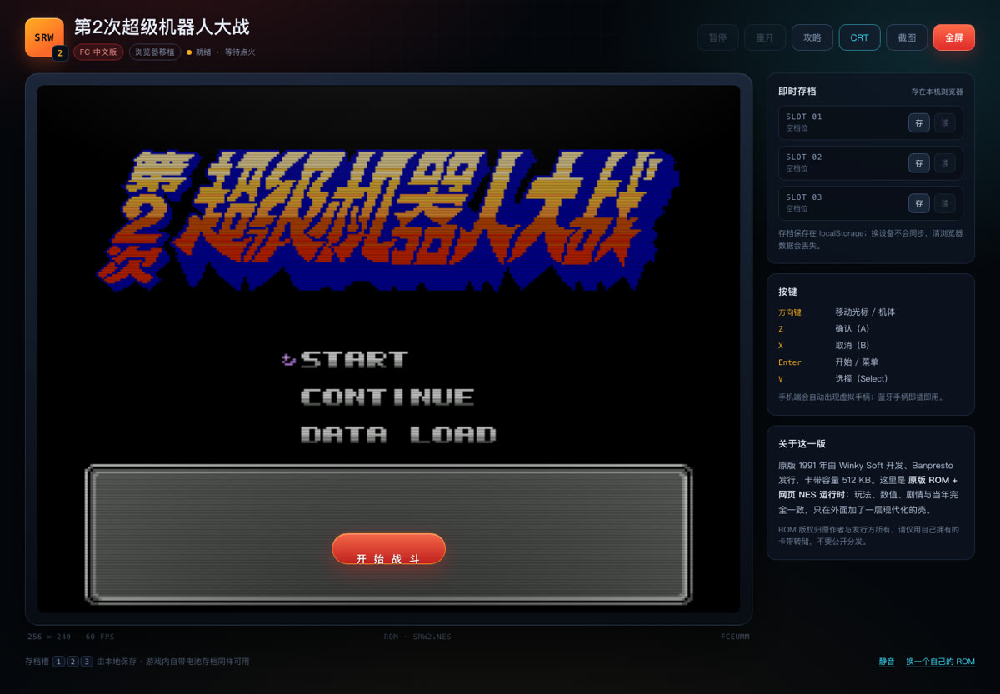
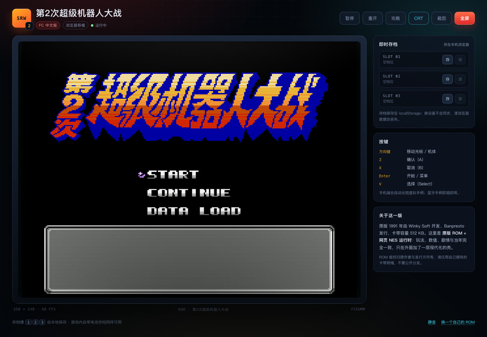

# 第2次超级机器人大战 · 网页版

> 1991 年 FC 卡带，2026 年在浏览器里重新点火。
> **原版 ROM + FCEUmm 运行时 + 一层现代外壳**：像素级重开，不是重制。

| 开始界面 | 进入游戏 |
| --- | --- |
|  |  |

---

## 玩

```bash
cd games/srw2-web
python3 -m http.server 8123 --bind 127.0.0.1
# 打开 http://127.0.0.1:8123
```

必须用 HTTP 打开（`file://` 会被 fetch/CORS 拦住）。

**ROM 需要自己准备**：把 `第二次机器人大战.nes`（512 KB，iNES，mapper 74）放到
`rom/srw2.nes`。没有也没关系——页面会提示你选择一个本地 `.nes` 文件。
也可以用 `?rom=<url>` 指定任意地址。

## 操作

| 键 | 作用 |
| --- | --- |
| 方向键 | 移动光标 / 机体 |
| Z | 确认（A） |
| X | 取消（B） |
| Enter | 开始 / 菜单 |
| V | 选择（Select） |

手机端会自动出现虚拟手柄；蓝牙手柄直接可用。

## 相对原版多了什么

| 原版 | 这一版 |
| --- | --- |
| 卡带电池存档 | **3 个即时存档槽**，随时存读，存在浏览器本地 |
| 只能全屏电视 | 全屏 + 自适应，手机竖屏可玩 |
| 无攻略 | **18 篇中文攻略**内置（关卡流程 / 升级心得 / 机体与机师代码表 / 剧情） |
| 实机 CRT | CRT 扫描线可开关，画面像素不糊 |
| — | 一键截图、暂停/继续、重开、静音 |

玩法、数值、剧情、敌方 AI 与 1991 年完全一致——因为跑的就是原版 ROM。

## 目录

```
srw2-web/
├── index.html                 页面骨架（机库风格外壳）
├── styles.css                 全部样式（含 CRT、全屏、移动端）
├── src/boot.js                ROM 探测 + EmulatorJS 配置注入
├── src/app.js                 存档/截图/暂停/攻略/兜底逻辑
├── assets/title.png           开始界面的标题画面（从模拟器截的原帧）
├── data/guides/               18 篇 GB18030 攻略 + index.json
├── rom/srw2.nes               ROM（.gitignore，不入库）
├── vendor/emulatorjs/data/    EmulatorJS 4.2.3 运行时 + FCEUmm 4.2.3 核心
└── tests/smoke.py             Playwright 冒烟验收
```

## 技术说明

- **ROM**：524,304 字节（16 字节 iNES 头 + 512 KB），PRG 16 bank / CHR 32 bank，
  垂直镜像，带电池存档，**mapper 74**（汉化改版常见）。
  SHA-256：`be486f5e61a845889e973c7283972afe6c2824af255b302e2733e73a09b86529`
- **核心**：FCEUmm（`@emulatorjs/core-fceumm@4.2.3`）。jsnes 不支持 mapper 74，所以没选它。
  没有 WebGL2 时自动回退 `fceumm-legacy-wasm.data`。
- **运行时**：EmulatorJS 4.2.3，`vendor/emulatorjs/data/` 自托管，**断网可玩**。
  上游发行包不含 `emulator.min.js`，loader 会自动回退加载 `data/src/*.js`，
  控制台那两条 warning 属正常现象。
- **存档**：`gameManager.getState()` → Uint8Array → base64 → localStorage，单档约 16 KB。
- **截图**：`gameManager.screenshot()` 返回 256×224 PNG。
- **攻略**：原包 txt 是 GB18030，浏览器用 `TextDecoder("gb18030")` 直接解码，不需要预转码。

## 验收

```bash
python3 tests/smoke.py
```

覆盖：首屏 → 开始 → 画面非黑 → 暂停/继续 → 存/读档 → 攻略正文 → 手机端无横向溢出 → 无 pageerror。

实测（Chromium headless，1440×1000 / 390×844）：

- 点击「开始战斗」后约 5 秒进入标题画面（START / CONTINUE / DATA LOAD）
- 存档 16 KB，刷新后仍在，读档成功
- 攻略 18 篇，中文无乱码
- 手机端 390×844 无横向滚动
- 控制台 0 `pageerror`（Wake Lock 权限拒绝属无头环境正常现象）

## 版权与许可

- 《第2次超级机器人大战》© 1991 Winky Soft / Banpresto。ROM 版权归权利人所有。
  仓库**不包含** ROM，请使用自己卡带的转储，仅供个人研究，不要公开分发或商用。
- EmulatorJS 为 **GPL-3.0**，FCEUmm 核心为 **GPL-2.0**，许可证见
  `vendor/emulatorjs/LICENSE`。分发本页面时请遵守相应开源义务。
- 内置攻略文本来自互联网社区（2009 年前后），仅作资料展示，版权归原作者。

## 已知限制

- 只支持 NES 的 `.nes` / iNES 格式；mapper 超出 FCEUmm 支持范围会失败。
- 存档与 ROM 绑定：换 ROM 版本后旧存档可能读不出来。
- 没有做 ROM 内部文本/数值表的提取（汉化 ROM 是 tile 索引 + 自定义字库，
  需要额外建映射）；攻略内容用的是社区文本。
- 移动端虚拟手柄在极窄屏（< 360px）会略挤。
