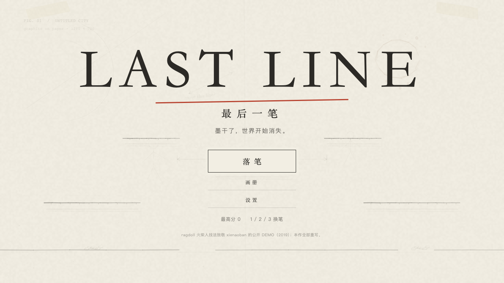
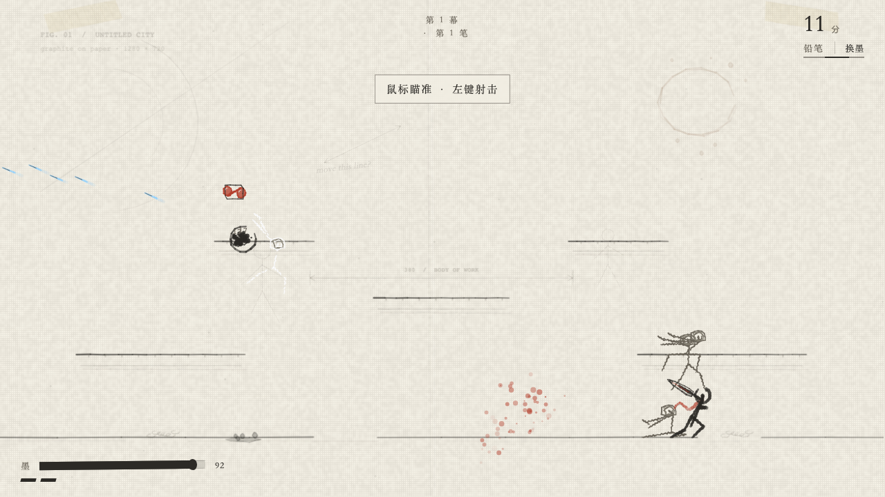
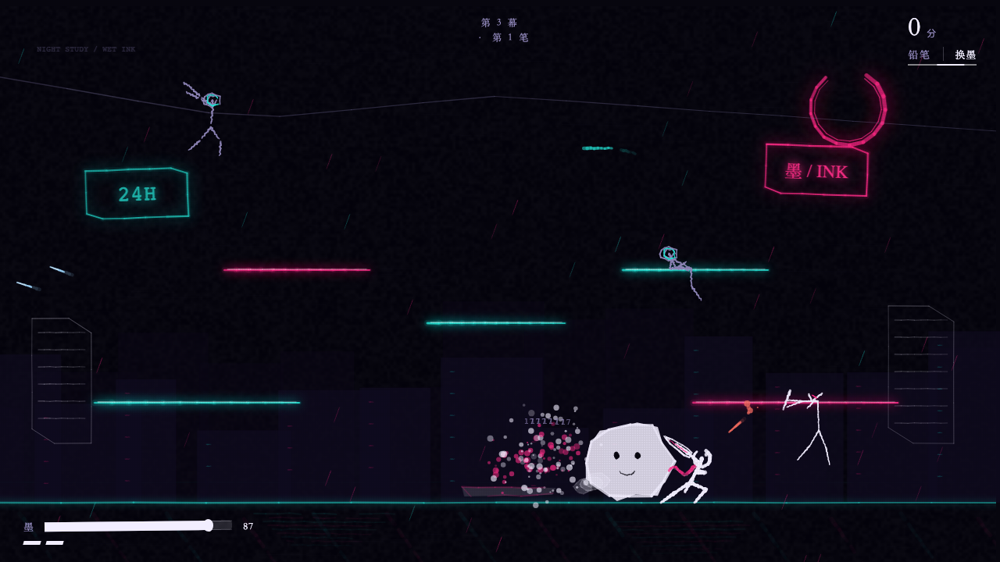
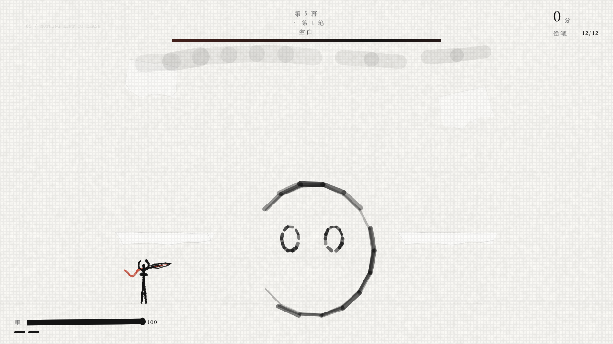

# LAST LINE / 最后一笔

> 一款画在纸上的 ragdoll 火柴人射击游戏。墨就是你的血，后坐力会把你推开。
> 5 幕 · 12 笔波次 · 3 把笔 · 16 种升级 · 三阶段 Boss · 双结局 · 中英双语。

**在线试玩：** https://pipygames.com/games/last-line-ink-ragdoll-stickman-shooter-zxc9
**YouTube 演示：** https://youtu.be/2vFzKFJK1Ck（Pipy Games 频道）
**演示视频（英）：** `playtest/lastline/last-line-demo.mp4`（42.8s / 8MB / 英文字幕）
**演示视频（中）：** `playtest/lastline/last-line-demo-zh.mp4`（42.8s / 8MB / 中文字幕）
**字幕：** `subtitles-en.srt` / `subtitles-zh.srt`　**hover GIF：** `last-line-hover.gif`

一座画出来的城正在干掉：画家停了笔，墨一天天干下去，没画完的东西开始被擦掉。你是他最后落下、还没画完的一笔——靠吸干别人的墨活下去，穿过草稿、蓝图、霓虹、水墨，直到画布尽头的空白，然后决定：把自己画完，还是给世界留白。

全部角色、地图、UI、音效与音乐均由代码实时生成（WebAudio + Canvas2D）。运行时不请求外部字体、图片、音频或 CDN，无需构建。

| | |
| --- | --- |
|  |  |
|  |  |

## 运行

```bash
cd games/stickman
python3 -m http.server 8124
# 打开 http://127.0.0.1:8124/
```

必须通过 HTTP 运行（ES Module 不支持 `file://`）。任意静态服务器和子目录都可用。

调试入口：

- `?lang=zh` / `?lang=en`：强制界面语言。
- `tools/renderbench.html`：渲染台（五张地图 / 七个角色 / 4 种动作 / 画质切换）。
- `window.__ll`：调试 API（`state` / `run` / `startAct(n)` / `demo.*` / `god()` / `win()`）。
- `window.G`：模块出口（`UI` / `Render` / `Audio` / `Save` / `i18n`）。

## 操作

| 动作 | 键鼠 | 触屏 |
| --- | --- | --- |
| 移动 | `A / D`、`← / →` | 左半屏摇杆 |
| 瞄准 | 鼠标 | 自动瞄最近敌人 + 摇杆微调 |
| 射击 | 左键（按住连发） | 射 |
| 跳跃 | `Space` | 跳 |
| 冲刺 | `Shift` | 冲 |
| 笔锋（近战 / 消弹） | 右键 | 锋 |
| 换笔 | `1 / 2 / 3` | 拾取后自动 |
| 换墨 | `R` | 换 |
| 暂停 | `Esc` / `P` | — |

**核心技巧**：每一枪的后坐力都会把身体推向反方向。在空中连续开枪，就能用后坐力飞起来。

## 游戏内容

- **5 幕，5 种画风**：草稿（铅笔纸）、蓝图（制图）、霓虹（湿墨夜城）、水墨（宣纸远山）、留白（Boss）。
- **12 笔波次 + Boss**：每笔清空后三选一升级，16 种升级不重复。
- **3 把枪**：铅笔（精准）、毛笔（散射 + 巨大后坐力）、针管笔（高速穿透）。
- **5 种敌人**：墨渣、断笔、圆规、涂抹、橡皮；每种都有 ragdoll 死亡。
- **Boss「空白」三阶段**：擦除带 → 冲锋 → 擦掉地面 + 墨雨。
- **墨即生命**：受伤掉墨、冲刺耗墨、击杀吸墨；升级改变整个循环。
- **故事**：4 张开场字卡、每幕画家旁白、8 段画册碎片、2 个结局。
- **存档**：最高分、进度、画册、语言 / 音量 / 画质设置。

## 测试与验收

```bash
node --test                          # 纯逻辑回归（ragdoll / 战斗 / 波次 / 升级 / Boss）
node tools/selfplay.mjs              # 无头自对弈：5 幕 + Boss
node tools/verify.mjs                # 浏览器全流程 + 截图 + 性能 + 资源检查
node tools/shot.mjs --out tests/artifacts/title.png --wait 1200
```

- `verify.mjs` 输出 `tests/artifacts/verify-report.json` 与 13 张关键截图；检查 0 console error / 0 404 / 0 外部请求、桌面与 844×390。
- 当前基线：`node --test` **54/54**；自对弈 **3:34 通关**（119 击杀 / 4085 分）；浏览器验收 **13/13**；60 FPS；音频 23/23 可闻。验收明细见 `docs/stickman/qa.md`。
- `shot.mjs` 自带静态服务器，可指定视口、注入 JS、点击、查询串。

## 目录

```text
index.html              入口（屏幕容器 + HUD + 触屏控件）
styles.css              墨线画册风 UI
config/                 全局数值 / 武器 / 敌人 / 升级 / 地图 / 中英文案
src/core/               i18n、存档、程序化音频
src/game/               ragdoll 物理、模拟、AI、波次（纯逻辑，可 node 跑）
src/render/             墨线渲染：纸、地图、角色、特效
src/ui/                 屏幕、HUD、动效
src/main.js             装配、60Hz 固定步长、流程状态机
tests/                  node:test 回归 + 验收截图
tools/                  截图、终验、自对弈、音频自检、美术合成
tests/final/            验收截图（标题/五幕/升级/结局/移动端）
legacy/                 原始火柴人 DEMO（只作技法参考）
post.jpg                1280×720 封面
poster.jpg              1920×1080 宣传图
favicon.png             256×256 图标
```

## 原创与依赖

玩法、角色、地图、UI 与音频均为原创实现；ragdoll 火柴人的物理技法致敬 [xienaoban](https://github.com/xienaoban) 2019 年的公开 DEMO，本作从零重写，未复制其代码与素材。无第三方运行期依赖。
